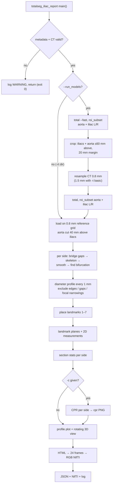
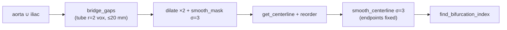

# Iliac artery report — technical documentation

Developer notes for `totalsegmentator/iliac_report/` (v0.1.0). For user documentation see
[iliac_report.md](iliac_report.md). Links point to the code at the time of writing; line numbers
may drift.

## Modules

| module | responsibility |
|---|---|
| [`bin/totalseg_iliac_report.py`](../totalsegmentator/bin/totalseg_iliac_report.py) | CLI: argument parsing, metadata, CT validation, writes NIfTI/JSON |
| [`pipeline.py`](../totalsegmentator/iliac_report/pipeline.py) | `create_iliac_report` generator, data loading, orchestration |
| [`model_runner.py`](../totalsegmentator/iliac_report/model_runner.py) | fast run → crop → full `total` run (subprocess) |
| [`centerline.py`](../totalsegmentator/iliac_report/centerline.py) | aorta cut, gap bridging, per-side centerline, bifurcation |
| [`landmarks.py`](../totalsegmentator/iliac_report/landmarks.py) | landmark placement on the centerlines |
| [`measurements.py`](../totalsegmentator/iliac_report/measurements.py) | landmark planes, diameter profiles, exclusions, section stats |
| [`plotting.py`](../totalsegmentator/iliac_report/plotting.py) | 3D view, diameter profile PNG, CPR overview |
| [`rendering.py`](../totalsegmentator/iliac_report/rendering.py) | HTML → 24 frames → RGB NIfTI, JSON results, cleanup |
| [`constants.py`](../totalsegmentator/iliac_report/constants.py) | landmark/section definitions and all tuning parameters |

Geometry, CPR and rendering helpers are reused from `aorta_report/` by import
(`get_centerline`, `draw_plane`, `get_2d_plane`, `cpr`, `lazy_load`, …); nothing in `aorta_report`
was changed.

## Flow chart



## Call stack

```text
main()                                              bin/totalseg_iliac_report.py:182
├─ _load_metadata / _validate_ct                    :19 / :138
└─ create_iliac_report()  (generator, yields progress)  pipeline.py:213
   ├─ _prepare_context, _resolve_ct_path            :51, :63
   ├─ _run_segmentation_models  [--run_models]      :80
   │  ├─ get_iliac_fast                             model_runner.py:58
   │  ├─ crop_to_iliacs → cut_aorta_above_iliacs    model_runner.py:69
   │  ├─ change_spacing (0.8 mm)
   │  └─ run_models_consecutive                     model_runner.py:105
   ├─ _load_report_data                             pipeline.py:104
   │  ├─ _validate_inputs                           :90
   │  ├─ crop_to_masks + change_spacing  (reference grid)
   │  ├─ lazy_load (CT order 3, masks order 0)
   │  └─ cut_aorta_above_iliacs, keep_largest_blob (aorta only)
   ├─ _build_centerlines                            pipeline.py:172
   │  └─ build_side_centerline                      centerline.py:129
   │     ├─ bridge_gaps                             centerline.py:45
   │     ├─ smooth_mask, get_centerline, reorder_centerline   (aorta_report)
   │     ├─ smooth_centerline                       centerline.py:93
   │     ├─ find_bifurcation_index                  centerline.py:112
   │     └─ resample_cl_to_same_distance (1 mm)
   ├─ compute_profiles                              measurements.py:254
   │  ├─ diameter_profile → plane_intersection      :151 → :52
   │  ├─ exclude_edges / exclude_near_gaps / exclude_focal_narrowings   :188 / :222 / :235
   ├─ place_landmarks → max_short_axis_index        landmarks.py:42 → :22
   ├─ create_landmark_planes                        measurements.py:63
   ├─ measure_landmarks                             measurements.py:90
   ├─ measure_sections → tortuosity_index           measurements.py:287 → :277
   ├─ _create_cpr → cpr, plot_iliac_cpr  [-c]       pipeline.py:189 → plotting.py:143
   ├─ plot_diameter_profiles, plot_iliac_seg        plotting.py:99, :34
   ├─ render_report_image, prepare_results          rendering.py:13, :36
   ├─ serialize_outputs, cleanup_workdir            rendering.py:56, :72
└─ _save_report                                     bin/totalseg_iliac_report.py:159
```

## Key methods

### Data loading — [`_load_report_data`](../totalsegmentator/iliac_report/pipeline.py#L104)
Builds a 0.8 mm isotropic reference grid from the iliac masks plus the aorta up to
`AORTA_CONTEXT_MM` above them (20 mm margin) and `lazy_load`s CT and masks onto it. The iliacs are
loaded with `is_mask=False` on purpose: `lazy_load`'s `keep_largest_blob` would drop fragments
separated by segmentation gaps. A side under `MIN_STRUCTURE_VOLUME_MM3` is zeroed.

### Centerline — [`build_side_centerline`](../totalsegmentator/iliac_report/centerline.py#L129)
One centerline per side through `aorta ∪ iliac_side`:



Index convention: **index 0 = distal iliac end, last index = aorta**, `bif_idx` = first point
below the aorta.

```text
 aorta end ●──────────●──────────────────────────────● distal end
  (last)     bif_idx  ↑ section / profile: centerline[0 : bif_idx+1]   (0)
```

- [`bridge_gaps`](../totalsegmentator/iliac_report/centerline.py#L45) returns `kept` (original
  voxels of the kept components, used for measurements) and `bridged` (plus tubes, used only for
  the skeleton). Bridged voxels become `gap_points`.
- [`find_bifurcation_index`](../totalsegmentator/iliac_report/centerline.py#L112): walking from the
  aortic end, the first point after which 2 consecutive points lie outside the aorta mask. Returns
  `None` (side dropped) if the aortic end is not inside the aorta.
- [`smooth_centerline`](../totalsegmentator/iliac_report/centerline.py#L93) removes the voxel
  staircase, which inflated length by ~8 % (tortuosity 1.08 for a straight tube).

### Diameter profile — [`compute_profiles`](../totalsegmentator/iliac_report/measurements.py#L254)
At every 1 mm point of the resampled iliac centerline a perpendicular plane is intersected with the
iliac mask ([`plane_intersection`](../totalsegmentator/iliac_report/measurements.py#L52),
undilated, closest blob) and major/minor (short-axis) diameters are computed. Then values are set to
NaN for:

| exclusion | function | rule | reported |
|---|---|---|---|
| section ends | [`exclude_edges`](../totalsegmentator/iliac_report/measurements.py#L188) | first/last 5 mm | no |
| segmentation gap | [`exclude_near_gaps`](../totalsegmentator/iliac_report/measurements.py#L222) | < 10 mm from a bridged voxel | JSON, HTML, log |
| focal narrowing | [`exclude_focal_narrowings`](../totalsegmentator/iliac_report/measurements.py#L235) | < 10 mm from a point with minor < 0.5 × median | JSON, HTML, log |

### Landmarks — [`place_landmarks`](../totalsegmentator/iliac_report/landmarks.py#L42)

| # | name | position |
|---|---|---|
| 1 | aortic bifurcation | `bif_idx` + 10 mm towards the aorta, right centerline (left fallback); measured on the aorta mask |
| 2 / 5 | R / L iliac prox. | `bif_idx` − 10 mm |
| 3 / 6 | R / L iliac max. | max of the 3-point median-filtered short-axis profile between prox. and distal ([`max_short_axis_index`](../totalsegmentator/iliac_report/landmarks.py#L22)); midpoint fallback |
| 4 / 7 | R / L iliac distal | index 0 + 10 mm |

Landmarks get `cl_side`/`cl_idx`; unplaceable ones are `empty` and produce `null` in the JSON.

### Measurements
- [`create_landmark_planes`](../totalsegmentator/iliac_report/measurements.py#L63): plane per
  landmark (normal from `get_normal_for_cl_point`), returns the largest preliminary diameter used to
  size the 2D crops and the CPR.
- [`measure_landmarks`](../totalsegmentator/iliac_report/measurements.py#L90): rotates the plane to
  2D (`get_2d_plane`), **projects the slab along z** (`any(axis=2)`) instead of taking one slice,
  then area and diameter / perpendicular diameter via `get_region_diameters_pd`.
- [`measure_sections`](../totalsegmentator/iliac_report/measurements.py#L287): `length`
  (centerline `bif_idx → 0`), `volume` (whole kept iliac mask), `max/min_diameter` (short axis of
  the non-excluded profile), [`tortuosity_index`](../totalsegmentator/iliac_report/measurements.py#L277)
  (path length / chord), `excluded_regions`.

### Output
- [`plot_iliac_cpr`](../totalsegmentator/iliac_report/plotting.py#L143): one row per side
  (sagittal, coronal CPR, profile); CPR built with `aorta_report.cpr.cpr` on
  [`vessel_image`](../totalsegmentator/iliac_report/plotting.py#L209), `max_diameter ≥ 20 mm`.
- [`render_report_image`](../totalsegmentator/iliac_report/rendering.py#L13) fills
  `resources/iliac_report/report_template_frontpage.html` and renders 24 frames;
  [`prepare_results`](../totalsegmentator/iliac_report/rendering.py#L36) strips internal keys for
  the JSON.

## Decisions

| decision | reason |
|---|---|
| Aorta is the anchor; one centerline per side through aorta + iliac | defines the bifurcation without a landmark model |
| No dilation of plane intersections (unlike `get_plane_aorta_intersection`) | dilation adds ~1.5 mm per diameter, ~15 % for iliacs |
| Slab projection in `measure_landmarks` | a single rotated slice under-measured with residual tilt |
| Centerline smoothing (σ = 3) | skeleton staircase overestimated length by ~8 % |
| Short-axis diameter for section max/min and the max landmark | long axis spikes (~26 mm) where the plane cuts the internal iliac origin |
| Bridge gaps ≤ 20 mm for the centerline only | masks often break at the CIA/EIA transition although the lumen is contrast-filled |
| Exclude + warn + report gaps and focal narrowings | user decision: don't let artifacts become min diameters, but keep them visible |
| Only `total` task, no Modal host / `-mp` | no license needed; a single model run makes parallelism pointless |

## Constants and parameters

All in [`constants.py`](../totalsegmentator/iliac_report/constants.py#L24).

| constant | value | used for |
|---|---|---|
| `AORTA_CONTEXT_MM` | 40 | aorta kept above the iliacs (crop uses +20) |
| `BIFURCATION_OFFSET_MM` | 10 | LM1 cranial of the bifurcation |
| `PROXIMAL_OFFSET_MM` | 10 | LM2/5 distal of the bifurcation |
| `DISTAL_OFFSET_MM` | 10 | LM4/7 proximal of the distal end |
| `EDGE_EXCLUSION_MM` | 5 | profile ends ignored |
| `MIN_STRUCTURE_VOLUME_MM3` | 200 | smaller iliac/aorta treated as empty |
| `MAX_GAP_MM` | 20 | largest gap bridged |
| `MIN_FRAGMENT_MM3` | 100 | smaller fragments dropped |
| `GAP_EXCLUSION_MM` | 10 | exclusion radius around gaps and narrowings |
| `NARROWING_RATIO` | 0.5 | focal narrowing threshold (× median minor diameter) |
| `PROFILE_CROP_MM` | 80 | crop around each profile point |
| `CENTERLINE_SMOOTHING` | 3 | gaussian σ in centerline points |
| `REPORT_FRAMES` / `REPORT_SMOOTHING` | 24 / 100 | 3D rendering |

Hard-coded elsewhere: 0.8 mm grid (1.5 mm with `-t basic`), 20 mm crop margins, bridge tube radius
2 voxels, mask dilation ×2 before skeletonization, bifurcation tolerance 2 points, CPR minimum
diameter 20 mm.

CLI ([`_build_parser`](../totalsegmentator/bin/totalseg_iliac_report.py#L55)): `-i`, `-rt`
(required without `-rm`), `-n`, `-o`, `-j`, `-l`, `-tmp`, `-c`, `-rm`, `-t`, `-d`, `-r`.

## Tests

| file | type | data | runtime |
|---|---|---|---|
| [`tests/test_iliac_report_geometry.py`](../tests/test_iliac_report_geometry.py) | unit, no GPU | synthetic phantom | seconds |
| [`tests/test_iliac_report.py`](../tests/test_iliac_report.py) | end-to-end CLI | AortaSeg24 `subject001_CTA.nii.gz` | ~3 min (GPU) |

**Phantom** ([`_phantom`](../tests/test_iliac_report_geometry.py#L46)): inverted Y at 0.8 mm,
aorta r = 8 mm, iliacs r = 5 mm, optional bulge (r = 7 mm, right), neck (right, r → 1.5 mm) and gap
(left). Checks bifurcation position, landmark offsets, max on the bulge, exact diameters/areas,
section stats (length, min/max, tortuosity 1.0), missing side, `bridge_gaps`,
`cut_aorta_above_iliacs`, and that narrowings/gaps are excluded and reported.

**End-to-end**: runs `--run_models -t basic --debug -c` and then `-rt` with the produced masks;
checks output files, 24 RGB frames, log content, plausible ranges, and compares the JSON with
[`tests/reference_files/iliac_report/iliac_report.json`](../tests/reference_files/iliac_report/iliac_report.json)
(±0.2, `start*/end*` ignored). The CT path defaults to
`../data/asg24/ResampledDataInNifti/images/subject001_CTA.nii.gz`, override with
`ILIAC_REPORT_TEST_CT`; skipped if missing. Neither file is wired into CI.

```bash
.venv/bin/pytest -q tests/test_iliac_report_geometry.py
PATH=$PWD/.venv/bin:$PATH .venv/bin/pytest -q tests/test_iliac_report.py
```

## Limitations / things to double check

- **Anatomy coverage**: `iliac_artery_*` masks cover common **and** external iliac (~20 cm), so
  length, volume, tortuosity and min diameter span CIA + EIA; the distal end is where the mask
  stops, not an anatomical landmark. No internal iliac.
- **Bifurcation** depends on where TotalSegmentator places the aorta/iliac label boundary; LM1 uses
  only one side's centerline.
- **Exclusions can hide pathology**: a real stenosis may be classed as "focal narrowing", and a
  bridged gap up to 20 mm could be an occlusion. Both are only flagged — review in the CPR. Diffuse
  narrowing is not detected (threshold is relative to the median).
- **Two diameter methods**: section max/min come from the 3D profile (short axis), landmark
  diameters from the rotated 2D plane (long + perpendicular). The "max." landmark diameter therefore
  does not equal `max_diameter`.
- **Volume** uses the whole kept iliac mask, including excluded regions.
- **Smoothing** with fixed σ may cut corners in very tortuous vessels (slight length
  underestimate).
- **No lumen/thrombus/calcium separation**; thresholds were tuned on contrast CTA only.
- **Validation**: 3 AortaSeg24 CTAs (subjects 001–003) by plausibility; no comparison against
  manual measurements.
- **Reference JSON** is from the `-t basic` (1.5 mm) run, not production spacing, and is derived
  from AortaSeg24 data — check the dataset license.
- **CLI validation** (metadata, image shape, age) logs a warning and returns with exit code 0.
- `model_runner` calls `TotalSegmentator` via subprocess: it must be on `PATH`.
- `plot_iliac_cpr` reuses private helpers of `aorta_report/plotting.py`; changes there can break it.
